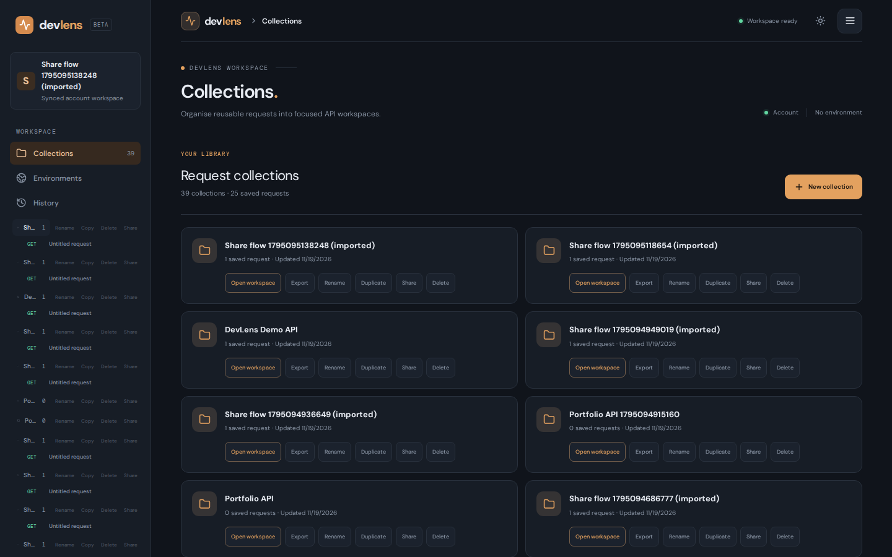
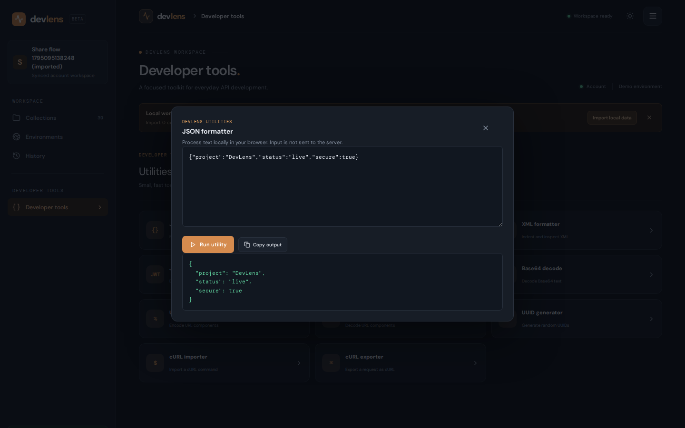
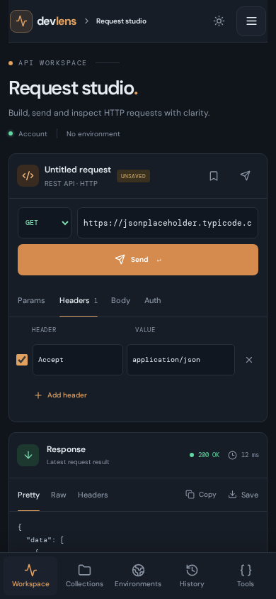
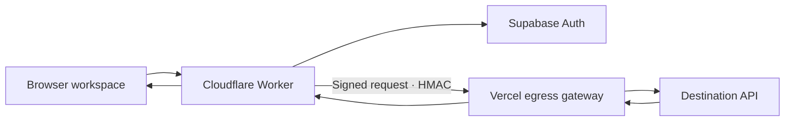

<div align="center">

# DevLens

### Make every API make sense.

A focused API development studio for building HTTP requests, inspecting responses, and organising API work in one secure workspace.

<p>
  <a href="https://devlens.cc.cd"><strong>Open DevLens ↗</strong></a> &nbsp;·&nbsp; <a href="https://github.com/theemeraldesign/devlens">Source code</a> &nbsp;·&nbsp; <a href="https://github.com/theemeraldesign/devlens/issues">Report an issue</a>
</p>

<p>
  <a href="https://devlens.cc.cd"></a>
  
  
  
  
</p>

</div>

---

## Product preview

The screenshots below are captured from the live production application using a dedicated test account. Demo data is used. Account identifiers and private values are masked.

<div align="center">
  <a href="docs/screenshots/landing-desktop.png">
    
  </a>
  <br/>
  <sub>Public landing page · Desktop</sub>
</div>

<details open>
  <summary><strong>Workspace and response inspector</strong></summary>
  <br/>
  <div align="center">
    
    <br/><sub>Request studio · Desktop</sub>
    <br/><br/>
    
    <br/><sub>Response inspector · Pretty JSON, status, timing and headers</sub>
  </div>
</details>

<details>
  <summary><strong>Collections, environments and sharing</strong></summary>
  <br/>
  <div align="center">
    
    <br/><sub>Saved collections and requests</sub>
    <br/><br/>
    
    <br/><sub>Environment variables · Demo values only</sub>
    <br/><br/>
    
    <br/><sub>Read-only public collection</sub>
  </div>
</details>

<details>
  <summary><strong>Developer utilities and mobile workspace</strong></summary>
  <br/>
  <div align="center">
    
    <br/><sub>Developer utilities</sub>
    <br/><br/>
    
    <br/><sub>Responsive workspace · Mobile</sub>
  </div>
</details>

---

## What you can do

| Workspace | Capabilities |
|:--|:--|
| Request studio | Compose GET, POST, PUT, PATCH, DELETE, HEAD and OPTIONS requests. Edit query parameters, headers, authentication and request bodies. |
| Collections | Save, organise, duplicate, rename, import and export API requests. |
| Environments | Store reusable variables and interpolate them into URLs, headers, parameters and bodies. |
| Response inspector | Inspect status, duration, size and headers. Switch between pretty and raw output. Format XML and download JSON, XML or text responses. |
| Request history | Review synced request metadata with sensitive URL values redacted. |
| Sharing | Publish read-only collections, share a link, import a shared collection and unpublish it. |
| Developer utilities | Format and diff JSON, format XML, inspect JWT payloads, encode/decode Base64 and URLs, generate UUIDs, and import/export cURL. |

## Security architecture

DevLens routes authenticated text-based API requests through a dedicated server-side egress gateway.



- The Worker validates the Supabase session and applies per-IP and per-user rate limits.
- HMAC signatures and timestamps authenticate requests between the Worker and gateway.
- The gateway uses guarded outbound fetching, DNS checks and connection-time IP pinning to reduce SSRF and DNS-rebinding risks.
- Private, loopback, link-local, metadata and reserved network destinations are blocked.
- Redirects are blocked. Send requests to the final destination directly.
- Request and response sizes, duration and response headers are capped.
- Cookies are stripped from gateway responses.
- Request history stores redacted metadata, not request or response bodies.
- Public collection pages expose sanitised, read-only snapshots.

Browser-based multipart file uploads remain subject to the destination API CORS policy. APIs that reject browser CORS need a compatible server-side request path. See the [security model](docs/SECURITY.md) for exact boundaries and limitations.

## Built with

| Layer | Technologies |
|:--|:--|
| Frontend | React 19, TypeScript, Vite, Tailwind CSS |
| Edge and hosting | Cloudflare Workers and Static Assets |
| Secure egress | Vercel serverless functions, guarded-fetch |
| Auth and data | Supabase Auth, PostgreSQL, Row Level Security |
| Quality | Vitest, Playwright, GitHub Actions |

## Run locally

### Requirements

- Node.js 22.23.4 or later in the 22.x line
- npm

### Setup

```bash
git clone https://github.com/theemeraldesign/devlens.git
cd devlens
npm install
cp .env.example .env.local
npm run dev
```

Set the following public client configuration in `.env.local`:

```env
VITE_SUPABASE_URL=your_supabase_project_url
VITE_SUPABASE_PUBLISHABLE_KEY=your_supabase_publishable_key
```

Never place a Supabase secret or service-role key in browser code.

### Quality checks

```bash
npm run typecheck
npm test
npm run build
npm run test:e2e
```

The authenticated Playwright suite requires a dedicated, email-confirmed test account:

- `DEVLENS_E2E_EMAIL`
- `DEVLENS_E2E_PASSWORD`

The secure egress gateway has a separate test suite:

```bash
cd gateway
npm install
npm test
```

## Project documentation

| Document | Purpose |
|:--|:--|
| [Setup guide](docs/SETUP.md) | Local setup and configuration |
| [Architecture](docs/ARCHITECTURE.md) | Application and service boundaries |
| [Deployment](docs/DEPLOYMENT.md) | Cloudflare, Vercel and CI deployment |
| [Security model](docs/SECURITY.md) | Authentication, egress controls and threat boundaries |
| [Sharing security](docs/SHARING.md) | Public collection publishing and sanitisation |
| [Completion roadmap](docs/ROADMAP.md) | Product scope and remaining work |
| [Release record](docs/RELEASE.md) | Production verification and release notes |
| [Screenshot guide](docs/SCREENSHOTS.md) | How production screenshots are refreshed |

## Project status

DevLens is live at **[devlens.cc.cd](https://devlens.cc.cd)**. Production CI verifies the build, unit tests, gateway tests, responsive browser flows, authentication-backed workspace operations and production routes.

Production email delivery still depends on completing sender-domain verification and SMTP setup in Brevo. This does not prevent the deployed workspace from loading.

## License

MIT
