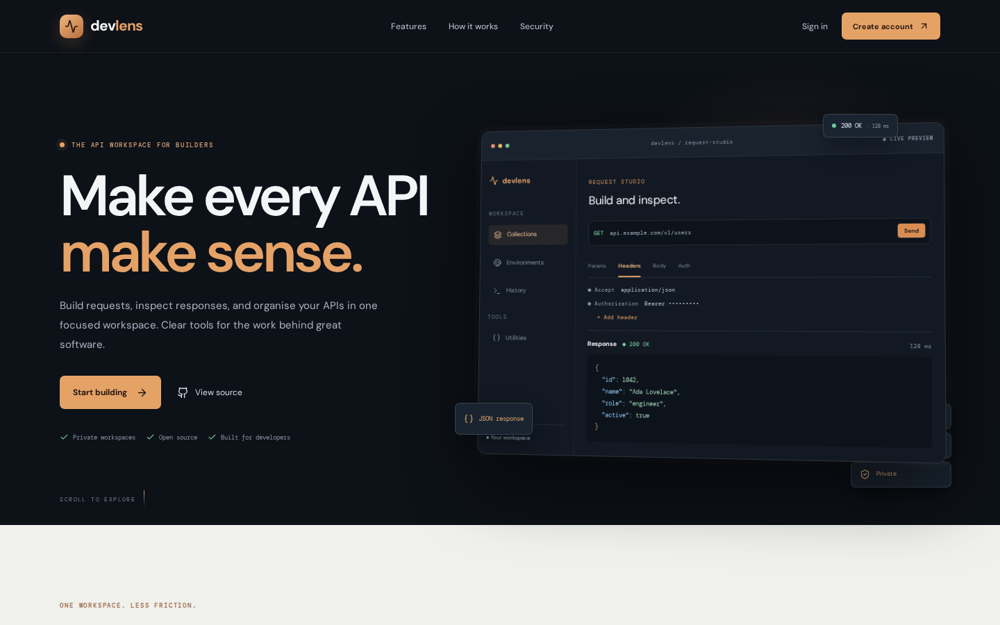
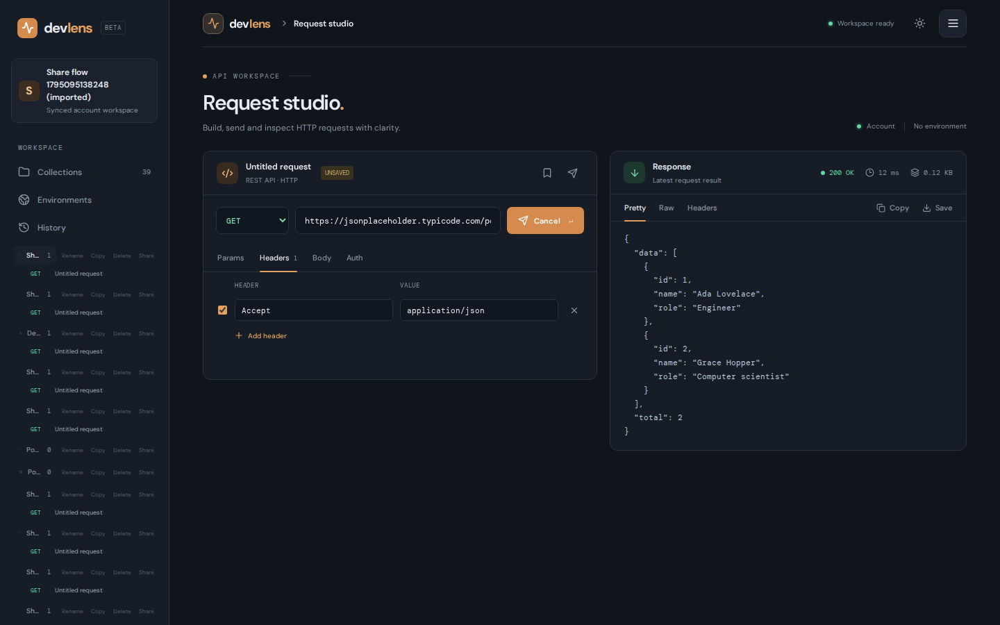
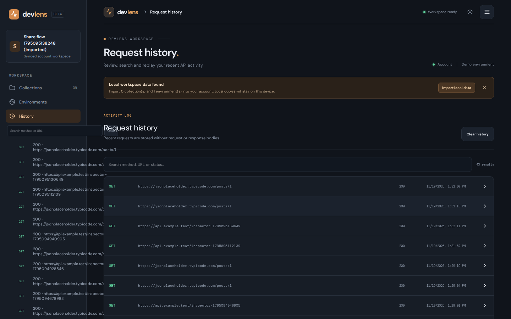
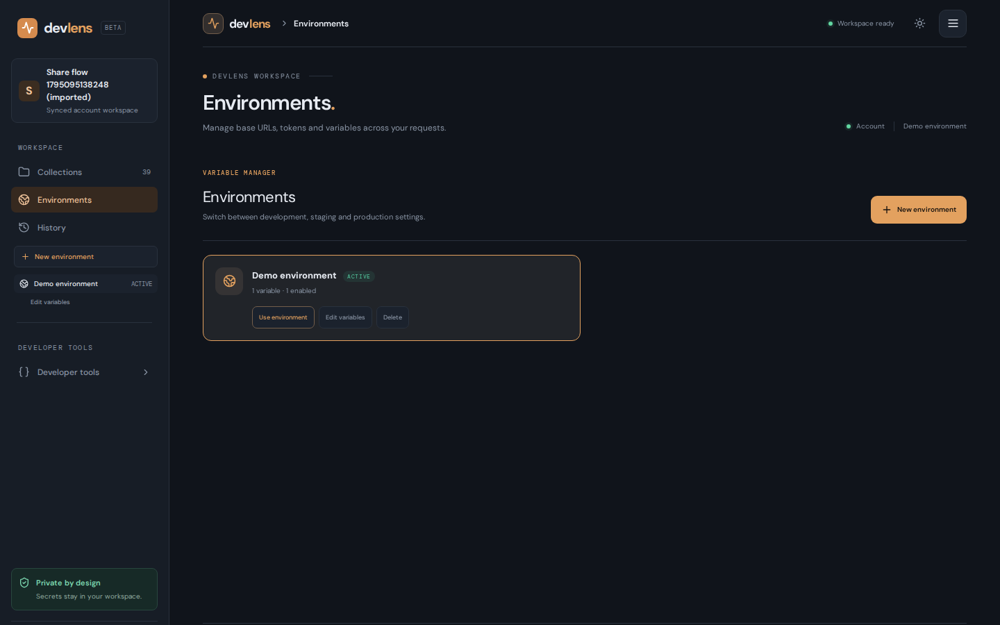
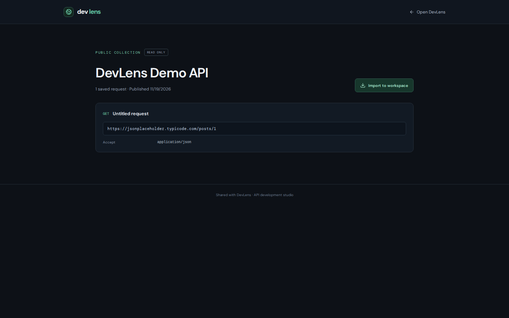
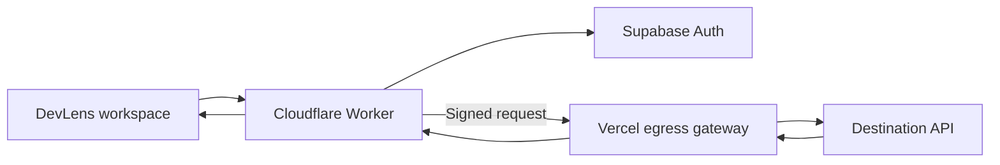

<div align="center">

# DevLens

### Make every API make sense.

A focused API development workspace for composing HTTP requests, inspecting responses, and keeping API work organised.

<p>
  <a href="https://devlens.cc.cd"><strong>Open DevLens ↗</strong></a> &nbsp;·&nbsp;
  <a href="https://github.com/theemeraldesign/devlens">Source code</a> &nbsp;·&nbsp;
  <a href="https://github.com/theemeraldesign/devlens/issues">Report an issue</a>
</p>

<p>
  <a href="https://devlens.cc.cd"></a>
  
  
  
  
</p>

</div>

---

## Overview

DevLens brings everyday API development tasks into one workspace. Build and send HTTP requests, inspect server responses, organise reusable requests, manage environment variables, and share read-only collections.

The interface is designed to keep request details easy to reach while making response data clear to inspect.

## Product preview

<div align="center">
  <a href="docs/screenshots/landing-desktop.png">
    
  </a>
  <br/>
  <sub>DevLens · Desktop landing page</sub>
</div>

<details open>
  <summary><strong>Request workspace and response inspector</strong></summary>
  <br/>
  <div align="center">
    
    <br/><sub>Compose and send API requests</sub>
    <br/><br/>
    
    <br/><sub>Inspect response status, timing, headers and formatted data</sub>
    <br/><br/>
    
    <br/><sub>Review recent request activity</sub>
  </div>
</details>

<details>
  <summary><strong>Collections, environments and sharing</strong></summary>
  <br/>
  <div align="center">
    
    <br/><sub>Organise saved requests</sub>
    <br/><br/>
    
    <br/><sub>Manage reusable environment values</sub>
    <br/><br/>
    
    <br/><sub>Share read-only collection snapshots</sub>
  </div>
</details>

<details>
  <summary><strong>Developer utilities and mobile workspace</strong></summary>
  <br/>
  <div align="center">
    
    <br/><sub>Built-in developer utilities</sub>
    <br/><br/>
    
    <br/><sub>Responsive mobile workspace</sub>
  </div>
</details>

---

## Features

| Area | Capabilities |
|:--|:--|
| Request studio | Compose GET, POST, PUT, PATCH, DELETE, HEAD and OPTIONS requests. Configure query parameters, headers, authentication and request bodies. |
| Collections | Save, organise, rename, duplicate, import and export API requests. |
| Environments | Store reusable variables and insert them into URLs, headers, parameters and request bodies. |
| Response inspector | Review status, duration, size and headers. View formatted or raw responses, format XML, and download JSON, XML or text. |
| Request history | Search and revisit recent API activity. Stored history contains redacted request metadata rather than request or response bodies. |
| Collection sharing | Publish read-only collection snapshots, share links, import shared collections and unpublish them. |
| Developer utilities | Format and compare JSON, format XML, inspect JWT payloads, encode and decode Base64 or URLs, generate UUIDs, and import or export cURL. |
| Accounts and guest mode | Work in a guest workspace or sign in to sync supported workspace data to an account. |

## Security

Authenticated API requests pass through a server-side egress gateway.



The request gateway applies destination and network safeguards designed to reduce server-side request forgery and DNS-rebinding risks. It blocks private and reserved network destinations, restricts redirects, and applies request and response limits.

Other security measures include:

- Supabase session validation for authenticated requests.
- Signed communication between the Cloudflare Worker and the egress gateway.
- Per-IP and per-user rate limits.
- Redaction of sensitive URL values in request history.
- Sanitised, read-only snapshots for public collections.
- No storage of request or response bodies in request history.

Browser-based multipart uploads are subject to the destination API's CORS policy. See the [security model](docs/SECURITY.md) for the detailed architecture, limitations and threat boundaries.

## Technology

| Layer | Stack |
|:--|:--|
| Frontend | React 19, TypeScript, Vite, Tailwind CSS |
| Edge runtime and hosting | Cloudflare Workers and Static Assets |
| Request gateway | Vercel serverless functions |
| Authentication and data | Supabase Auth, PostgreSQL and Row Level Security |
| Testing | Vitest, Playwright and GitHub Actions |

## Run locally

### Requirements

- Node.js 22.x
- npm

### Installation

```bash
git clone https://github.com/theemeraldesign/devlens.git
cd devlens
npm install
cp .env.example .env.local
```

Add the public Supabase client settings to `.env.local`:

```env
VITE_SUPABASE_URL=your_supabase_project_url
VITE_SUPABASE_PUBLISHABLE_KEY=your_supabase_publishable_key
```

Start the development server:

```bash
npm run dev
```

Never place a Supabase secret or service-role key in frontend code.

### Run checks

```bash
npm run typecheck
npm test
npm run build
npm run test:e2e
```

The authenticated end-to-end tests require a dedicated test account configured through the test environment. The request gateway has its own test suite:

```bash
cd gateway
npm install
npm test
```

## Documentation

- [Local setup](docs/SETUP.md)
- [Architecture](docs/ARCHITECTURE.md)
- [Deployment](docs/DEPLOYMENT.md)
- [Security model](docs/SECURITY.md)
- [Collection sharing](docs/SHARING.md)
- [Product roadmap](docs/ROADMAP.md)
- [Release notes](docs/RELEASE.md)
- [Screenshot guide](docs/SCREENSHOTS.md)

## Project status

DevLens is available at **[devlens.cc.cd](https://devlens.cc.cd)**. The application is actively maintained, with automated checks covering builds, unit tests and browser workflows.

## License

MIT. See [LICENSE](LICENSE).
